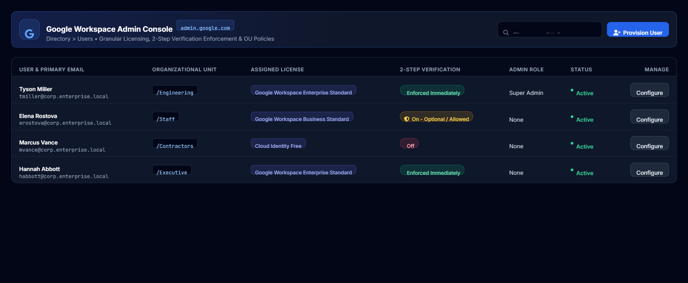

# Enterprise IAM Lab Runbook & Diagnostic Log

> **Repository Placement:** Save this file as `IAM-Labs/Google-Workspace-INC-43371/README.md` with screenshots stored inside `IAM-Labs/Google-Workspace-INC-43371/Images/`.

- **Engineer:** Tyson Miller
- **Date:** 2026-11-18
- **Training Methodology:** AI-Assisted Enterprise Sandbox + Confidence-Rated PBQ Simulation (CompTIA Security+ SY0-701 Domain 3.2)

## Phase 1: Ticket Triage & Initial Directory Assessment (`INC-43371`)
- **Ticket Title:** Urgent Offboarding & License Reclamation: Marcus Vance
- **Target Platform:** Google Workspace
- **Requester:** IT Security Incident Response
- **Scenario Objective:** Contract has concluded for Marcus Vance (mvance@corp.enterprise.local). Immediately revoke access, move the object to the /Suspended OU, strip any administrative roles, and reclaim their paid license by setting it to "No License".

### Initial Console Baseline

## Phase 2: Identity Provisioning & Security Policy Enforcement
### Technical Acceptance Criteria Executed
- [x] Locate mvance@corp.enterprise.local in Google Workspace
- [x] Change Account Status to: Suspended
- [x] Move Organizational Unit to: /Suspended
- [x] Set License Tier to: No License (reclaim seat)
- [x] Ensure Admin Role is set to: None

## Phase 3: Automated PBQ Verification & Security+ Analysis
### Security+ (SY0-701) Architecture Takeaway
> **Diagnostic Question:** During enterprise offboarding, why do administrators suspend an account and move it to a /Suspended OU instead of immediately deleting the user object?
>
> **Enterprise Principle:** Suspending an account revokes active sessions and blocks sign-in immediately while retaining data for compliance, legal hold, and ownership transfer before eventual archival or deletion.

## Phase 4: Immutable Directory Audit Trail
| Timestamp | Platform | Target Object | Administrative Action |
| :--- | :--- | :--- | :--- |
| `10:57:46` | System | `Multi-Tenant IAM Sandbox` | Initialized corp.enterprise.local directories (Google Workspace, ADUC, M365) |
