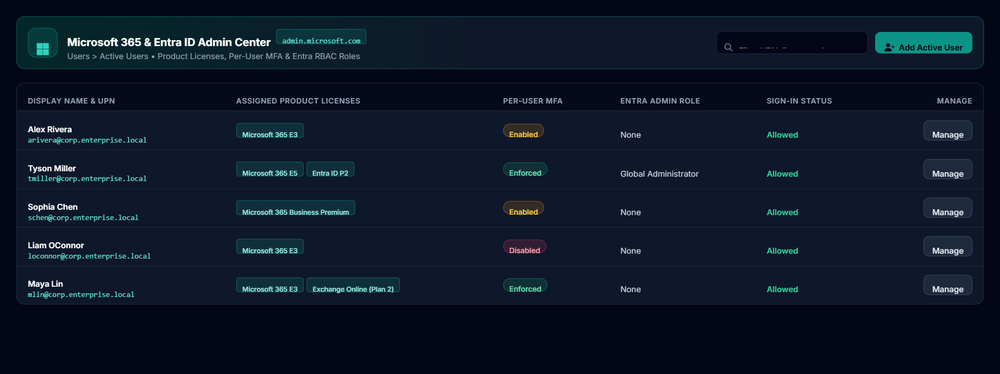

# Enterprise IAM Lab Runbook & Diagnostic Log

> **Repository Placement:** Save this file as `IAM-Labs/Microsoft-365-INC-49087/README.md` with screenshots stored inside `IAM-Labs/Microsoft-365-INC-49087/Images/`.

- **Engineer:** Tyson Miller
- **Date:** 2026-11-18
- **Training Methodology:** AI-Assisted Enterprise Sandbox + Confidence-Rated PBQ Simulation (CompTIA Security+ SY0-701 Domain 3.2)

## Phase 1: Ticket Triage & Initial Directory Assessment (`INC-49087`)
- **Ticket Title:** IT Staff Onboarding & Security Hardening
- **Target Platform:** Microsoft 365
- **Requester:** IT Security Manager
- **Scenario Objective:** Alex Rivera is transitioning from a general staff role to the IT Help Desk Tier 1. We need to perform a security uplift on this account. Upgrade the user to an E5 license for full audit logging capabilities, assign the Helpdesk Administrator role, and elevate MFA from 'Enabled' to 'Enforced'. Ensure the previous E3 license is removed to reclaim the seat.

### Initial Console Baseline

## Phase 2: Identity Provisioning & Security Policy Enforcement
### Technical Acceptance Criteria Executed
- [x] Assign the 'Microsoft 365 E5' license to Alex Rivera.
- [x] Remove the 'Microsoft 365 E3' license from the account.
- [x] Set the MFA status to 'Enforced'.
- [x] Assign the 'Helpdesk Administrator' directory role.

## Phase 3: Automated PBQ Verification & Security+ Analysis
### Security+ (SY0-701) Architecture Takeaway
> **Diagnostic Question:** When upgrading a user to an administrative role in Microsoft 365, why is it critical from a security perspective to change the MFA state from 'Enabled' to 'Enforced' if Conditional Access is not yet configured?
>
> **Enterprise Principle:** In the M365 per-user MFA settings, 'Enabled' means the user is prompted for MFA the first time they sign in, but 'Enforced' ensures that the MFA requirement is strictly applied across all supported authentication flows, providing a stronger security posture for privileged accounts.

## Phase 4: Immutable Directory Audit Trail
| Timestamp | Platform | Target Object | Administrative Action |
| :--- | :--- | :--- | :--- |
| `14:33:34` | Gemini AI Engine | `INC-49087` | Synthesized live Microsoft 365 PBQ scenario: "IT Staff Onboarding & Security Hardening" |
| `14:32:44` | Active Directory | `INC-41761` | Ticket validation PASSED (Confidence: High) |
| `14:32:32` | Active Directory | `CORP\jhayes` | Modified properties | Groups: [Domain Users, HelpDesk_Tier2, VPN_Users] | Disabled: false |
| `14:32:09` | Active Directory | `CORP\jhayes` | Modified properties | Groups: [Domain Users, VPN_Users] | Disabled: false |
| `14:30:35` | System | `Multi-Tenant IAM Sandbox` | Initialized corp.enterprise.local directories (Google Workspace, ADUC, M365) |
