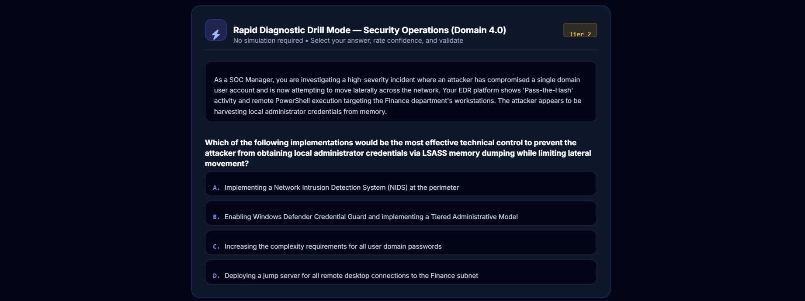
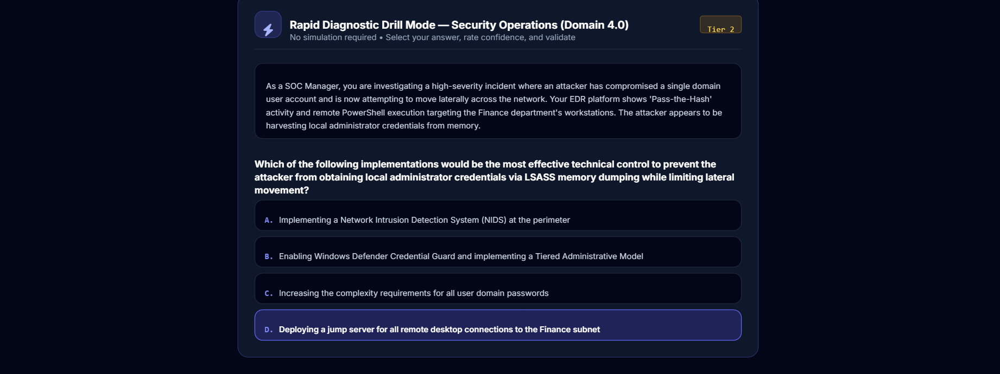

# Enterprise IAM Lab Runbook & Diagnostic Log

> **Repository Placement:** Save this file as `IAM-Labs/Security-Operations-Domain-4-0-QZ-9740/README.md` with screenshots stored inside `IAM-Labs/Security-Operations-Domain-4-0-QZ-9740/Images/`.

- **Engineer:** Tyson Miller
- **Date:** 2026-11-18
- **Training Methodology:** AI-Assisted Enterprise Sandbox + Confidence-Rated PBQ Simulation (CompTIA Security+ SY0-701 Domain 3.2)

## Phase 1: Ticket Triage & Initial Directory Assessment (`QZ-9740`)
- **Ticket Title:** Mitigating Lateral Movement in Corporate Environments
- **Target Platform:** Security Operations (Domain 4.0)
- **Requester:** Rapid Diagnostic Drill Mode
- **Scenario Objective:** As a SOC Manager, you are investigating a high-severity incident where an attacker has compromised a single domain user account and is now attempting to move laterally across the network. Your EDR platform shows 'Pass-the-Hash' activity and remote PowerShell execution targeting the Finance department's workstations. The attacker appears to be harvesting local administrator credentials from memory.

### Initial Console Baseline

## Phase 2: Identity Provisioning & Security Policy Enforcement
### Technical Acceptance Criteria Executed
- [x] Select the best technical answer in the Diagnostic Console
- [x] Rate your pre-submit confidence
- [x] Click Validate & Close Ticket

## Phase 3: Automated PBQ Verification & Security+ Analysis
- **Verification Status:** IN PROGRESS
- **Pre-Submit Confidence Rating:** Medium

- [FAIL] **Diagnostic Answer Selection (Enabling Windows Defender Credential Guard and implementing a Tiered Administrative Model)** — `You chose: Deploying a jump server for all remote desktop connections to the Finance subnet`

### Final Verified Directory State

### Security+ (SY0-701) Architecture Takeaway
> **Diagnostic Question:** Which of the following implementations would be the most effective technical control to prevent the attacker from obtaining local administrator credentials via LSASS memory dumping while limiting lateral movement?
>
> **Enterprise Principle:** Windows Defender Credential Guard uses virtualization-based security to isolate secrets like LSASS so that only privileged system software can access them, which directly mitigates credential harvesting. A Tiered Administrative Model (Tier 0, 1, 2) ensures that domain admin credentials are never used on lower-trust assets like workstations, preventing an attacker from capturing high-privilege hashes to move laterally from a compromised workstation.

## Phase 4: Immutable Directory Audit Trail
| Timestamp | Platform | Target Object | Administrative Action |
| :--- | :--- | :--- | :--- |
| `14:45:53` | Security Operations (Domain 4.0) | `QZ-9740` | Ticket validation FAILED (Confidence: Medium) |
| `14:44:52` | Gemini AI Engine | `QZ-9740` | Synthesized live Security Operations (Domain 4.0) PBQ scenario: "Mitigating Lateral Movement in Corporate Environments" |
| `14:43:57` | Incident Response and Management | `QZ-3364` | Ticket validation FAILED (Confidence: Medium) |
| `14:42:37` | Gemini AI Engine | `QZ-3364` | Synthesized live Incident Response and Management PBQ scenario: "SOC Manager Diagnostic: DMZ Exfiltration vs. Maintenance" |
| `14:41:35` | Operations and Incident Response | `QZ-7565` | Ticket validation PASSED (Confidence: High) |
| `14:40:26` | Gemini AI Engine | `QZ-7565` | Synthesized live Operations and Incident Response PBQ scenario: "Containment Strategy for Data Exfiltration" |
| `14:33:34` | Gemini AI Engine | `INC-49087` | Synthesized live Microsoft 365 PBQ scenario: "IT Staff Onboarding & Security Hardening" |
| `14:32:44` | Active Directory | `INC-41761` | Ticket validation PASSED (Confidence: High) |
| `14:32:32` | Active Directory | `CORP\jhayes` | Modified properties | Groups: [Domain Users, HelpDesk_Tier2, VPN_Users] | Disabled: false |
| `14:32:09` | Active Directory | `CORP\jhayes` | Modified properties | Groups: [Domain Users, VPN_Users] | Disabled: false |
| `14:30:35` | System | `Multi-Tenant IAM Sandbox` | Initialized corp.enterprise.local directories (Google Workspace, ADUC, M365) |
